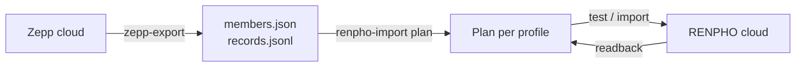

# How it works

The two tools share one neutral file format. You can read and edit the files between the two steps.

## Export files

`members.json` is a JSON array. One object for each member: `member_id`, `name`, `is_baby`, `birthday`.

`records.jsonl` has one JSON object for each line, one line for each reading:

| Field | Unit |
|---|---|
| `member_id` | Zepp member id, `-1` for the owner |
| `timestamp` | UTC epoch seconds |
| `weight_kg`, `muscle_kg`, `bone_kg` | kg |
| `body_fat_pct`, `water_pct`, `protein_pct` | 0 to 100 |
| `bmi`, `visceral_fat` | index |
| `bmr_kcal` | kcal per day |
| `body_age` | years |
| `impedance` | ohm |
| `height_cm` | cm |
| `timezone` | IANA zone name, or empty |
| `raw` | the original Zepp row |

An empty value means that the scale did not measure it.

## Zepp side

`zepp-export` reads the family list and then the weight history of each member, 200 rows for each page, back to the first reading. It removes duplicates by member and second.

Zepp marks each row with a `weightType`. The export keeps types 0 (scale), 1 and 2 (baby weighing and manual entries in real data). It drops each row that has a `thirdPackage` value. Zepp writes this value on rows that it copied from another app, for example Google Fit (type 7). These rows can be RENPHO readings that came back to Zepp through Health Connect. An import of these rows makes duplicates.

Zepp `muscleRate` is muscle mass in kg, not a percentage. The export writes it to `muscle_kg`.

## RENPHO side

### Template

The RENPHO upload route needs the scale fields of a real reading: device type, scale address (`mac`), measurement method and the profile fields. These values are different for each scale model. The tool does not contain fixed values. For each destination profile, it copies them from the newest reading of that profile (the template). With `--borrow-owner-template`, a profile without readings uses the owner's template. See [Babies and pets](family-members.md).

The tool sends a metric only if the template contains it and the Zepp reading has a value for it.

| Zepp record | RENPHO field |
|---|---|
| `weight_kg` | `weight` |
| `bmi` | `bmi` |
| `body_fat_pct` | `bodyfat` |
| `water_pct` | `water` |
| `muscle_kg` | `sinew` |
| `bone_kg` | `bone` |
| `protein_pct` | `protein` |
| `visceral_fat` | `visfat` |
| `bmr_kcal` | `bmr` |
| `body_age` | `bodyage` |
| `impedance` | `resistance` |

Baby profiles receive `weight` only.

### Time

Each reading keeps its original UTC second. The local time and the GMT offset come from the reading's zone, or from `--timezone` (default `Europe/Rome`). The offset is the one in force on that date, so summer and winter readings get the correct offset.

### Safety checks

| Check | Effect |
|---|---|
| `--account-id` | The tool stops if the signed-in account is different |
| Plan | A reading at the same second with different values is a conflict. The tool does not upload while a conflict remains |
| Test first | `import` refuses a profile until at least one reading of that profile is verified |
| Confirmation | Each upload asks you to type `UPLOAD` |
| Readback | After each group of 10, the tool reads the history again and stops at the first reading that does not match (tolerance 0.055) |
| Pacing | 5 seconds after each upload and 5 seconds before the next group |
| Duplicates | A reading that is already in RENPHO at the same second with the same values is skipped |

### Debug files

`--debug` writes each API answer to a JSON file. The tool replaces tokens, passwords and app tokens with `[REDACTED]` or `[redacted]`. The files still contain health data and scale addresses.

## APIs

These are private APIs, found by other open-source projects (see Credits in the README).

| Side | Call | Use |
|---|---|---|
| Zepp | `POST api-user.huami.com/registrations/{email}/tokens`, `POST account.huami.com/v2/client/login` | Password login |
| Zepp | `GET /v1/sport/run/history.json` | Token check |
| Zepp | `POST /huami.health.scale.familymember.get.json` | Family list |
| Zepp | `GET /users/{uid}/members/{fid}/weightRecords` | Weight history |
| RENPHO | `renpho-py` login and history routes | Login, profiles, history |
| RENPHO | `POST RenphoHealth/scale/uploadMeasureData/` | Upload, AES encrypted JSON array |
